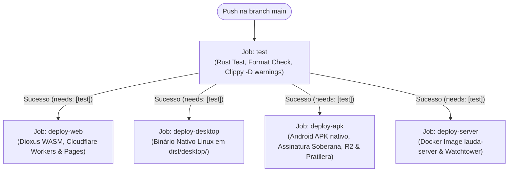

# Especificação Técnica: Esteira Completa de Compilação Multi-Alvo e Deploy Contínuo no Push

**ID do Ticket:** #61  
**Norma:** GOST 1.4.0 (DD-TDD)  
**Status:** Especificado (Fase 3)  
**Responsável:** Lumen Pink / Antigravity  

---

## 1. Contexto e Motivação Soberana (GOST)

Conforme a diretriz soberana da organização e da norma GOST:
> **A única forma oficial e autorizada de deploy no ecossistema é a esteira automatizada de CI executada no evento de push para a branch principal (`main`).**
> Deploys manuais ou ad-hoc são proibidos. A esteira é o único agente soberano de entrega de software. Durante o ciclo contínuo de desenvolvimento, as versões de desenvolvimento (`-dev...`) são tratadas como estáveis para todos os efeitos de empacotamento, distribuição e atualização.

Atualmente, o repositório `lauda` apresentava duas falhas estruturais críticas:
1. **Ausência da Compilação de APK na CI:** O workflow `.forgejo/workflows/ci.yml` não continha o job de build do Android APK nativo. O binário `site/lauda-latest.apk` permaneceu na compilação antiga de 10 de outubro de 2026 (`0.2.0-nightly...`), deixando os usuários sem as novas funcionalidades (como a Agenda Soberana).
2. **Falsa Detecção de Desatualização no Cliente:** Em `lauda-client/src/ui/mod.rs`, a checagem de versão invocava `check_update(env!("CARGO_PKG_VERSION"), &manifest)`. Como `CARGO_PKG_VERSION` em `Cargo.toml` estava fixo em `0.2.0`, o app julgava estar defasado em relação a `version.json` (que apontava `0.4.0` ou `0.4.1`), disparando indevidamente o banner de atualização.

---

## 2. Topologia do Pipeline Unificado no Push (`ci.yml`)

A cada push na branch `main`, a esteira deve executar o gate de testes e, em seguida, compilar e distribuir todos os 4 alvos em paralelo:

### 2.1. Contrato do Job `deploy-apk`
- **Ambiente:** Execução em container com Android NDK/SDK ou ambiente host com `dx` e Gradle.
- **Etapas:**
  1. `sync-version-manifests.sh`: Sincroniza `version.json` e `version-nightly.json` com o arquivo canônico `VERSION`.
  2. Compilação Android via Dioxus / Gradle (`scripts/publish-nightly.sh` ou runner nativo).
  3. Strip das bibliotecas JNI compartilhadas (`arm64-v8a` e `x86_64`).
  4. Assinatura soberana oficial com a keystore `in_twolp_release.keystore` (SHA-256 `7beec8b0a6c7946b04d538543d495a8210ad6cfc1859f42e7180bcfbd38fe582`).
  5. Atualização atômica de `site/lauda-latest.apk` e `site/lauda-nightly.apk`.
  6. Envio dos APKs para o bucket Cloudflare R2 (`lauda-downloads`) quando as credenciais estiverem disponíveis.
  7. Sincronização automática com a Pratilera (`/home/lumen/src/banca/site/pratilera/lauda-latest.apk`) e regeneração do catálogo F-Droid se o diretório irmão existir.

### 2.2. Contrato de Resolução de Versão no Cliente (`lauda-client`)
- A função de checagem em `lauda-client/src/ui/mod.rs` deve passar a versão canônica do build `env!("LAUDA_APP_VERSION")`.
- `lauda-client/Cargo.toml` deve ter sua versão alinhada com a versão base do workspace.
- `check_update` deve reconhecer sufixos `-dev` de mesmo nível ou superior como atualizados (`UpdateStatus::UpToDate`).

---

## 3. Critérios de Aceite e Verificação

1. **Pipeline de CI:** O arquivo `.forgejo/workflows/ci.yml` contém explicitamente os jobs `test`, `deploy-web`, `deploy-desktop`, `deploy-apk` e `deploy-server`, todos com `needs: [test]`.
2. **Detecção de Versão Correta:** Teste automatizado validando que uma compilação `0.4.1-dev...` comparada com manifesto `0.4.0...` ou `0.4.1-dev...` retorna `UpdateStatus::UpToDate`.
3. **Assinatura Soberana do APK:** O APK gerado pela automação possui assinatura oficial verificável via `apksigner verify --print-certs`.
4. **Zero Intervenção Manual:** Nenhum comando manual de build/deploy deve ser necessário após o `git push origin main`.
5. **Auditoria Gosplan:** `cargo test` verde, clippy sem warnings e `cccp check --strict` com conformidade 100%.
