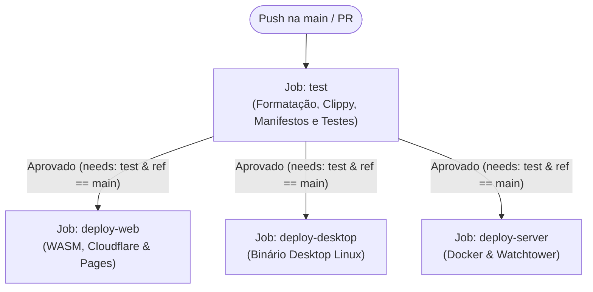

# Especificação Técnica: Unificação Canônica do Pipeline de CI/CD (`ci.yml`)

**ID do Ticket:** #53  
**Norma:** GOST 1.4.0 (DD-TDD)  
**Status:** Especificado (Fase 3)  
**Responsável:** Lumen Pink / Antigravity  

---

## 1. Contexto e Motivação

Atualmente, o repositório possuía dois arquivos de automação separados:
- `.forgejo/workflows/test.yml`
- `.forgejo/workflows/deploy.yml`

Conforme detalhado no `GOST.md` (Seção 6, `GOST-10-CI-SEPARATION`), a esteira de integração contínua deve seguir o padrão canônico adotado nos projetos da organização (como `banca` e `lacraia`):
1. **Unificação Estrutural:** Centralização no arquivo canônico `.forgejo/workflows/ci.yml`.
2. **Encadeamento Estrito:** Os jobs de distribuição e implantação (`deploy-web`, `deploy-desktop`, `deploy-server`) devem declarar explicitamente `needs: [test]` e condição `if: github.ref == 'refs/heads/main'`.
3. **Isolamento Local (`act`):** O executor local `act`, disparado pelo hook `pre-push` (`cccp hook pre-push`), aciona exclusivamente o job `test` (`act -j test`). Os jobs de deploy declarados no mesmo arquivo são ignorados durante a validação pré-push local.
4. **Prevenção de Deploy Concorrente:** A remoção dos arquivos fragmentados (`test.yml` e `deploy.yml`) elimina a execução prematura ou em paralelo de deploys caso a suíte de testes venha a falhar.

---

## 2. Topologia do Pipeline Unificado (`ci.yml`)

---

## 3. Critérios de Aceite e Verificação

1. **Existência do arquivo canônico:** `.forgejo/workflows/ci.yml` presente e sintaticamente válido.
2. **Eliminação de concorrência:** Arquivos `.forgejo/workflows/test.yml` e `.forgejo/workflows/deploy.yml` devem ser excluídos.
3. **Contrato de Dependência:**
   - Job `test` presente e sem dependências anteriores.
   - Todos os jobs de deploy declaram `needs: [test]`.
   - Todos os jobs de deploy condicionam execução a `github.ref == 'refs/heads/main'`.
4. **Validação Automática:** Teste unitário e de conformidade em `e2e_apk_test.rs` aprovando a nova topologia.
5. **Auditoria Gosplan:** `cccp check --strict` com 100% de conformidade.
